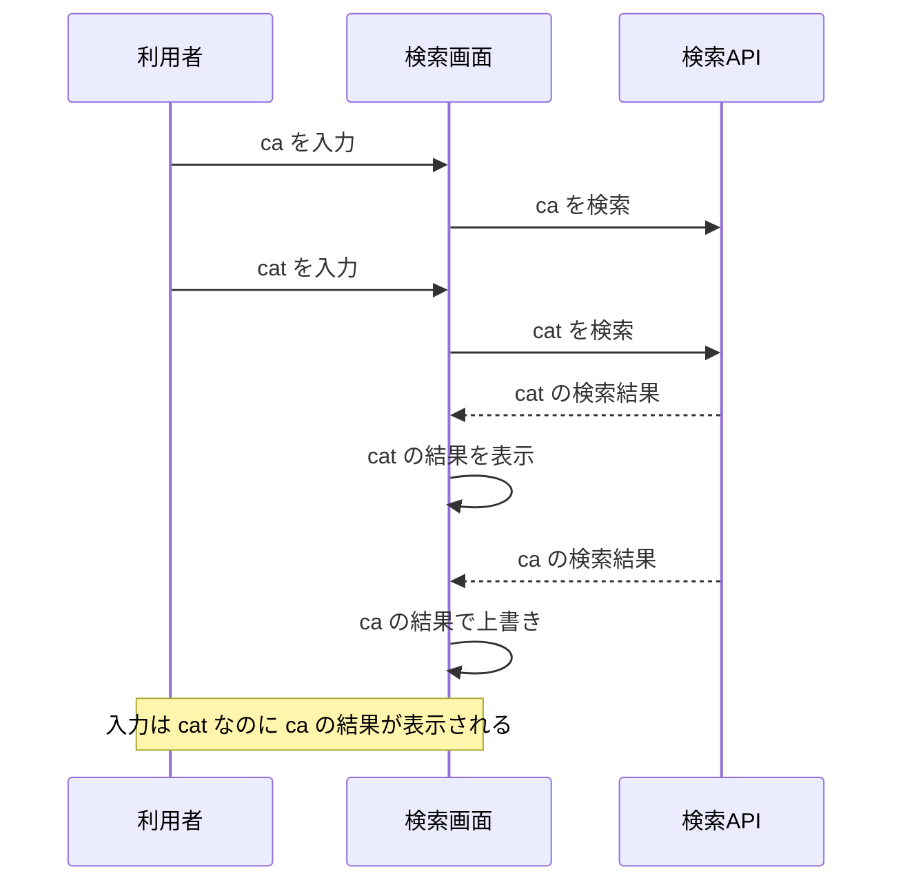
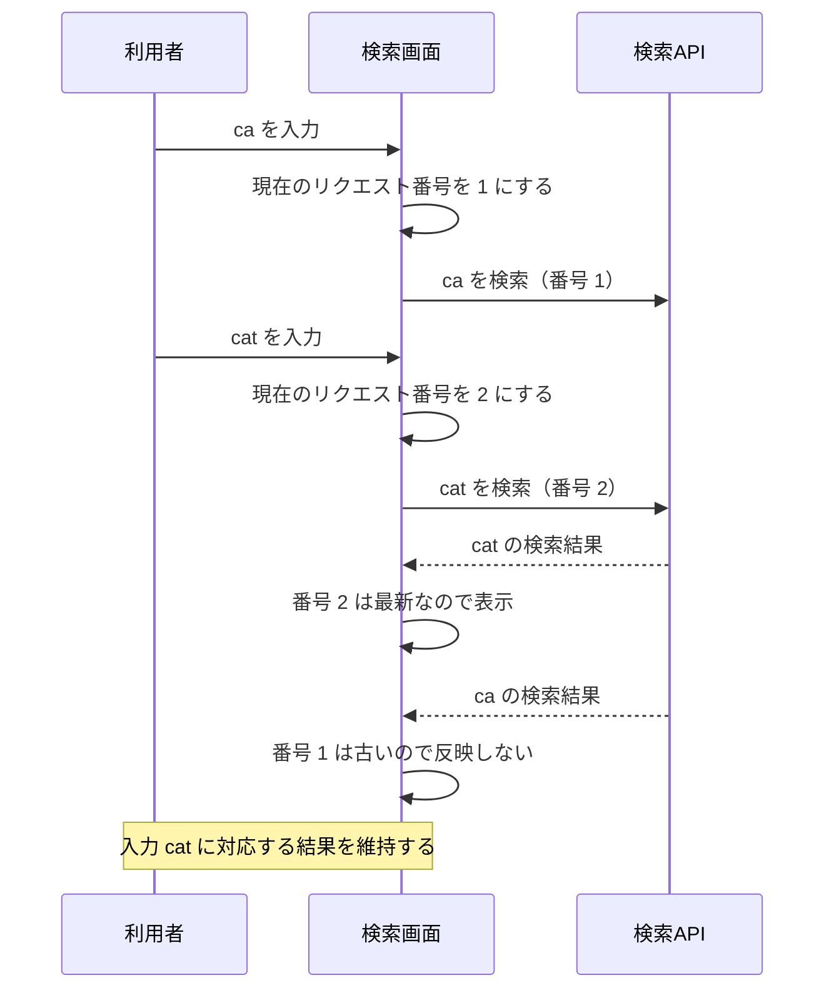
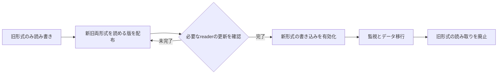

# 図と比較表の例

以下は説明方法の例であり、実際の障害・仕様・計測結果ではない。
登場人物、数値、分岐、制約を対象のコードと根拠に合わせて置き換える。

## Bugfix：検索結果の応答順序が逆転する場合

仮に、検索欄で「ca」の直後に「cat」と入力すると、先に送った「ca」の応答が遅れて届き、
現在の入力に合わない検索結果で画面が上書きされるとする。
Before / After は同じ入力順と応答順で比較し、最新のリクエストだけを表示へ反映する違いを示す。

### Before

### After

この例の番号は画面側でリクエストと応答を対応付ける値で、API の変更を前提としない。
図の後では、応答順序を制御したテストの結果と、エラー表示・ローディング状態などの確認範囲を説明する。
debounce は送信頻度を減らすが、送信済みリクエストの応答順序は保証しない。
キャンセルを代替案に挙げるなら、利用する通信処理のキャンセル保証を確認して比較する。
図が示す経路を実際に確認できていなければ、推定であることを明記する。

## Feature：互換性と有効化の順序

設定ファイルに形式バージョンを導入し、「先に新旧両方を読めるようにし、後で新形式を書き始める」設計を採る場合の例。
この順序が必要か、旧版が実際に何を読めるかは対象の仕様から確認する。

各段階の確認条件、停止方法、切り戻し先を本文で示す。
新形式を書いた後に旧版へ戻せるとは限らないため、逆向きの矢印を根拠なく描かない。

| 組み合わせ | 確認すること |
|---|---|
| 旧writer → 新reader | 既存データ・既定値を同じ意味で扱えるか |
| 新writer → 旧reader | 読めるか、拒否するか、データを壊すか。どの段階でこの組み合わせを避けるか |
| 新writer → 新reader | 新しい契約とエラー処理が成立するか |

## Perf：数値と条件を一緒に示す

結果表には実測値だけを入れる。未計測を0や改善率で表さない。

| 指標 | Before（base） | After（head） | 変化 | 条件・集計 |
|---|---|---|---|---|
| レイテンシ | 実測値＋単位 | 実測値＋単位 | 絶対差と増減率 | データ量、並列数、中央値またはpercentile、試行回数 |
| 処理量 | 実測値＋単位 | 実測値＋単位 | 絶対差と増減率 | 測定時間、入力条件 |
| RSS | 実測値＋単位 | 実測値＋単位 | 絶対差と増減率 | OS、ツール・カウンタ、プロセス範囲、peak / 定常値、測定区間 |
| Physical Memory Usage | 実測値＋単位 | 実測値＋単位 | 絶対差と増減率 | ツール上の定義とカウンタ名、対象範囲、peak / 定常値、測定区間 |

表の近くにリビジョン、環境、再現コマンド、元データへのリンクを置く。
RSS と Physical Memory Usage の定義を揃えずに一つのメモリ指標へまとめない。
取得できない値は「未計測」とし、別の指標で代用して改善率を出さない。
複数のデータ量や並列数を測った場合は、グラフで改善・悪化する領域を示してもよい。
